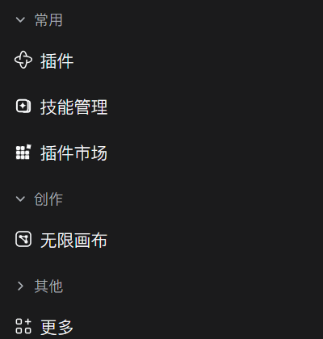

# Plugin Sidebar

English | [中文](README.md)


A plugin for DeepSeek Harness. It manages the column of panel entries in the top-left corner of DSH: it sorts the buttons that other plugins put there into categories you define, allows a second level of nesting, and hides entries you never open. Everything is adjusted in Settings → Plugin Sidebar and applies immediately, with no restart.

- Package: `dsh-plugins-sidebar-manager`
- Version: `0.1.0`
- License: MIT
- Platform: Web (DSH Desktop and `dsh web` both use the Web shell)



The screenshot above is the real thing: three top-level categories ("常用", "创作", "其他"), with "其他" collapsed. "更多" below is the shell's own entry and stays untouched.

---

## Table of contents

- [What it solves](#what-it-solves)
- [Features](#features)
- [Installation](#installation)
- [Usage](#usage)
- [Configuration and data](#configuration-and-data)
- [Host API](#host-api)
- [How it works](#how-it-works)
- [Compatibility and limits](#compatibility-and-limits)
- [Development](#development)
- [License](#license)

---

## What it solves

The DSH top-left sidebar is an open slot called `sidebar.panellist`. Any plugin that wants an icon entry there registers a record into that slot and picks an `order` number. The shell sorts those records by `order` and draws them as one flat column, then stops.

That mechanism is simple and sufficient, but it has a side effect: once there are many entries, the column becomes a pile of unrelated icons. With a dozen plugins installed it gets hard to tell at a glance which row is the board, which is the canvas, and which is some plugin's debug panel, because the shell only understands numbers, not purposes.

This plugin adds that layer back:

- You define categories, such as "Authoring", "Tools", "Debug"
- Categories nest, with second-level groups indented under the first
- Every entry can be shown or hidden on its own, without uninstalling the plugin
- A category title collapses on click, taking its members with it
- When the sidebar collapses to an icon rail, titles hide themselves instead of breaking the layout

It does not modify any other plugin's code and does not require other plugins to cooperate. It only lays out the column you see.

---

## Features

**Categories**

- First-level categories: group titles at the top of the sidebar
- Second-level categories: nested under a first-level group, indented, useful for splitting a large category further
- Rename, move up, move down, delete
- Collapsible, with the collapsed state remembered
- Deleting a category does not lose entries; its members fall back to "Ungrouped"

**Entries**

- Each entry can be placed in any one category
- Order inside a category can be rearranged
- Each entry can be hidden or shown on its own; a hidden entry disappears from the sidebar while the plugin keeps running
- Ungrouped entries follow all categories, in the order the plugins registered them

**Overall**

- A "Manage the sidebar" master switch; turning it off restores the plugin-registered order immediately, without losing your setup
- "Rescan" re-reads every currently registered sidebar entry
- "Reset" clears all categories and hidden flags, behind a two-click confirmation

---

## Installation

### Option 1: install from GitHub

In the DSH plugin manager (the "Plugins" page in the sidebar), click install and enter the repository address:

```
github:HighToward/dsh-plugins-sidebar-manager
```

Or on the command line, handing the same address to the profile's package manager:

```bash
dsh plugin --profile desktop add github:HighToward/dsh-plugins-sidebar-manager
```

Or straight through pnpm:

```bash
cd ~/.dsh/profiles/desktop
pnpm add github:HighToward/dsh-plugins-sidebar-manager
```

### Option 2: link a local directory

Useful when you want to change the code. Clone the repository anywhere, then make the profile depend on it through `link:`:

```bash
cd ~/.dsh/profiles/desktop
pnpm add link:/absolute/path/to/dsh-plugins-sidebar-manager
```

Then append the package name to the `dsh.profile.bundles` list in the profile's `package.json`:

```json
{
  "dsh": {
    "profile": {
      "bundles": [
        "...",
        "dsh-plugins-sidebar-manager"
      ]
    }
  }
}
```

For a `link:` install, host-half source changes need a DSH restart; the browser half applies on the next page refresh.

### After installing

Open Settings. A new entry, "Plugin Sidebar", appears in the left navigation, right after "Plugins". The sidebar entries also start being managed.

The plugin list shows this package under its localized name and one-line description, both read from `locale/zh.json` and `locale/en.json` inside the package.

---

## Usage

### Step 1: create a category

Go to Settings → Plugin Sidebar and click "New group". The name may be left blank; a blank group shows an empty title in the sidebar, so giving it a name is recommended.

When you need one more level, click "New sub-group" inside a first-level card and it attaches to that group automatically. A second-level group can also be re-parented with the "Parent" dropdown, or set to "None", which promotes it to a first-level group.

### Step 2: move entries in

At the bottom of each category card there is a dropdown and an "Add" button. The dropdown lists only entries that are not yet grouped. Pick one and click "Add" to move it out of "Ungrouped" and into this category.

The middle of the card is this category's member list. Each row has:

| Control | Effect |
| --- | --- |
| ↑ ↓ | Move up or down one position inside the category |
| Eye icon | Hide or show this entry; hidden rows dim and carry a "Hidden" badge |
| × | Remove this entry from the category, back to "Ungrouped" |

### Step 3: shape the sidebar itself

The `▾ / ▸` button in a card header collapses the category. While collapsed, its members are hidden in the sidebar too; the title stays and one click brings them back.

The ↑ ↓ buttons in a card header order first-level categories. Second-level groups do not take part in that ordering; they follow their parent.

### Master switch

"Manage the sidebar" in the toolbar is the master switch. Turning it off:

- restores the plugin-registered order immediately
- keeps every category and hidden flag you set
- brings your layout back when turned on again

Useful for checking whether this plugin is the reason the sidebar looks off.

### Reset

"Reset" clears all categories and hidden flags. The first click turns the label into "Click again to confirm"; a second click within 3 seconds performs it. This only clears the layout document and uninstalls nothing.

---

## Configuration and data

### Where it lives

The document is stored twice, as backups of each other:

| Location | Purpose |
| --- | --- |
| Browser `localStorage`, key `dsh.plugins-sidebar-manager.v1` | The sidebar is already organized on first paint, without waiting for the network |
| `$DSH_HOME/plugins-sidebar-manager.json` | Survives a browser cache wipe and travels with a profile copy |

`$DSH_HOME` defaults to `~/.dsh`; when the environment variable is set, it wins.

Write strategy: every change writes `localStorage` first, then POSTs to the host half behind a 400 ms debounce. The host writes to disk with a temporary file plus an atomic rename, so a half-written file never appears.

Clearing the browser cache does not lose the layout; it is read back from the host copy on the next load. Conversely, a missing host copy is not an error: the plugin treats it as "never configured" and leaves the sidebar in its native order.

### Document shape

```json
{
  "version": 1,
  "enabled": true,
  "groups": [
    { "id": "g1", "name": "Authoring", "level": 1, "parent": "", "collapsed": false },
    { "id": "g2", "name": "Video", "level": 2, "parent": "g1", "collapsed": false }
  ],
  "items": {
    "skill-manager": { "group": "g1", "order": 0, "hidden": false },
    "infinite-canvas": { "group": "g1", "order": 1, "hidden": true }
  }
}
```

Fields:

| Field | Type | Meaning |
| --- | --- | --- |
| `version` | number | Document version, currently always `1` |
| `enabled` | boolean | Master switch; `false` means the sidebar is not managed at all |
| `groups[].id` | string | Group id, generated by the plugin, shaped like `g1` |
| `groups[].name` | string | Display name, may be empty |
| `groups[].level` | 1 \| 2 | First or second level |
| `groups[].parent` | string | Parent id for a second-level group; empty for a first-level one |
| `groups[].collapsed` | boolean | Whether the group is collapsed |
| `items[<entry id>]` | object | Keyed by sidebar entry id |
| `items[].group` | string | Owning group id; empty means ungrouped |
| `items[].order` | number | Sort value inside the group, smaller first |
| `items[].hidden` | boolean | Whether the entry is hidden |

An entry id is the `options.id` that plugin used when registering `sidebar.panellist`, for example `skill-manager` or `task-board`.

### Tolerance

A document is normalized as soon as it is read; anything invalid is dropped rather than trusted:

- a top level that is not an object is treated as an empty document
- a group with a missing or duplicate id is skipped
- a `level` that is not 2 is treated as 1
- a second-level group whose parent is gone is **promoted to first level** rather than dropped. The reason is plain: dropping a group scatters every entry under it, while promoting at least keeps the grouping
- `items` pointing at a group that no longer exists have their `group` cleared, so the entry returns to ungrouped
- every field with the wrong type falls back to its default

A truncated, hand-edited, or older document never crashes the sidebar.

---

## Host API

The host half mounts on DSH's `webServer` and exposes two paths:

| Method and path | Request | Response |
| --- | --- | --- |
| `GET /api/dsh-plugins-sidebar-manager/config` | none | `{ "document": {...} }`; `{ "document": {} }` when nothing is saved |
| `POST /api/dsh-plugins-sidebar-manager/config` | `{ "document": {...} }` | `{ "ok": true }` |
| `GET /api/dsh-plugins-sidebar-manager/health` | none | `{ "ok": true, "path": "<absolute config path>" }` |

Constraints:

- Only loopback callers are accepted (`127.0.0.1`, `::1`, `127.*`, `::ffff:127.*`); anything else gets `403 { "error": "local-only" }`
- A wrong method returns `405`
- The body limit is 512 KiB; an oversized or unparseable body returns `400`
- Every response carries `cache-control: no-store`

The API only reads and writes your own layout preference. Nothing sensitive is involved, but it is still not opened to remote callers: a remote page has no business rewriting your sidebar.

---

## How it works

This part is worth spelling out, because grouping a sidebar sounds like it "should be easy" and is in fact the only genuinely hard part of the implementation.

### Why there is no official hook

`sidebar.panellist` is a **list slot**. The shell walks every registration in that slot, renders one button per entry, and orders them by the `order` each plugin declared.

It provides no:

- slot for inserting a "group title" into that column
- interface letting plugin A change plugin B's `order`
- notion of a "category" at all

In other words, grouping has nowhere to live at the slot layer. For a grouping to exist, it has to live on the rendered DOM.

### So here is what the plugin does

After the page loads, the plugin decorates that column:

1. **Identify the column.** Not by CSS class names, which are CSS Module hashes that change with every release, but by content: walk every `nav` on the page, count how many of its child buttons carry `aria-label`s that match the labels reported by the slot registry itself, and take the highest-scoring `nav`.
2. **Leave React's nodes alone.** Every button the shell rendered stays where it is; the plugin only writes their `style`.
3. **Order visually through CSS `order`.** The column is a flex container, so visual order comes from `order` and is independent of DOM order.
4. **Hide with `display: none`.** Hidden entries stay in the list, so un-hiding one drops it back where it belongs instead of appending it at the bottom.
5. **Insert titles as sibling nodes.** These `<button class="cem-group">` elements are created by the plugin, were never part of React's element tree, and are left untouched by React re-renders.

### Why CSS `order` and not moving nodes

This is the load-bearing decision of the whole implementation.

React re-inserts its children by fiber position on every render. `appendChild` a button somewhere else and the next render snaps it back. A locale change, a panel switch, any shell re-render triggers it.

`order` is different: React does not manage the `style` attribute on those buttons, so whoever writes it keeps it. Visual order therefore survives re-renders.

### Staying in sync

- A `MutationObserver` watches subtree changes on `body` plus `aria-label` / `aria-current` attribute changes, and each change schedules one pass
- A pass is deduplicated with `requestAnimationFrame`, so a frame costs one computation
- Store changes schedule a pass directly
- A 3-second fallback tick covers two cases observation cannot see: the shell mounting the sidebar very late, and a render that only swaps text without a structural change
- Every `style` / `setAttribute` write compares the current value first and skips when equal. Otherwise the observer would treat the plugin's own writes as external changes and loop forever

### The rail state

The sidebar can collapse to a 36 px icon rail, where every row is icon only and a title has nowhere to sit. The plugin measures each row's actual width (greater than 0 and `<= 40`) to detect that state, sets `data-cem-rail="1"` on the column, and a CSS rule hides all titles.

### Failure behavior

The whole enhancement runs inside `try / catch`. A failure logs one `[plugins-sidebar-manager] sidebar pass failed` line and never throws outward. The reason: DSH's Web shell aborts its whole boot when a plugin's `apply` throws. A layout organizer must not be able to take the GUI down.

---

## Compatibility and limits

**Requirements**

- DSH `>= 0.2.1-rc.2`
- React 18 or newer (it uses `useSyncExternalStore`, available from React 18)

The plugin has no runtime dependencies of its own. `react` and the `@deepseek-ai/*` packages are injected by the DSH shell when it loads the module (the `require` inside `client.js` resolves against the shell's module table), so `peerDependencies` declares only `react`, marked `optional`. Installing the plugin does not pull a second copy of React or of DSH itself.

**Known boundaries**

- The enhancement depends on the DOM the shell renders. If the shell changes the sidebar container tag (currently `nav`) or stops putting entry labels on `aria-label`, identification fails. The failure mode is the sidebar staying native: no error, no damage to anything else.
- Two entries with exactly the same display name are told apart by matching them in registration order. If registration order and render order disagree, they may be paired wrongly. This is rare among real plugins.
- Entry labels come from each plugin's own `label` and follow the interface language. The plugin reads live labels, so it keeps matching after a language switch.
- Group titles are nodes the plugin inserted; they are focusable buttons and work with the keyboard, but they do not participate in any special focus-loop handling.
- The host API is loopback only. If you reach DSH through a remote port forward, config reads and writes are refused, while the saved layout still applies from `localStorage`.

**Data safety**

- The plugin reads and writes only its own config file, never another plugin's data
- The config contains no credentials
- Uninstalling does not delete `$DSH_HOME/plugins-sidebar-manager.json`; to clean up fully, remove that file and the `localStorage` key by hand

---

## Development

### Layout

```
dsh-plugins-sidebar-manager/
├── index.js             host half: webServer routes, config file I/O
├── client.js            browser half: sidebar enhancement + settings section
├── cordis.patch.yml     bundle patch, inserts the plugin into the profile tree
├── package.json         manifest, declares dsh.bundle and dsh.client
├── icon.svg             plugin icon, used by the plugin list and the settings nav
├── locale/
│   ├── zh.json          localized name and description for the plugin list
│   └── en.json          English name and description
├── LICENSE
├── README.md
└── README.en.md
```

The two halves are exposed separately through `package.json` `exports`: `.` is the host entry and `./client` is the browser entry. `dsh.client.platform` is declared as `web`.

### Local debugging

```bash
# Syntax check; neither file needs a build step
node --check index.js
node --check client.js

# Host half
curl http://127.0.0.1:<dsh port>/api/dsh-plugins-sidebar-manager/health
curl http://127.0.0.1:<dsh port>/api/dsh-plugins-sidebar-manager/config
```

Browser-half changes show up on a page refresh. Host-half changes need a DSH restart.

### No build step

`client.js` registers its module directly through `window.__ModuleLoader__.load`, and dependencies such as `react` are supplied by the shell through `require`. Editing the code needs no bundling.

### Styling conventions

Every color, radius, and spacing value comes from DSH theme variables (`--dsw-alias-*`, `--dsh-sidebar-*`, `--dsw-radius-*`); no colors are hardcoded. The plugin therefore follows DSH's light and dark themes automatically. The one exception is the white knob of the switch.

Group titles deliberately match the shell's own sidebar row metrics for size, padding, and hover background, so they read as part of the sidebar rather than as something stuck on top.

---

## License

MIT, see [LICENSE](LICENSE).

Copyright (c) 2026 HighToward
